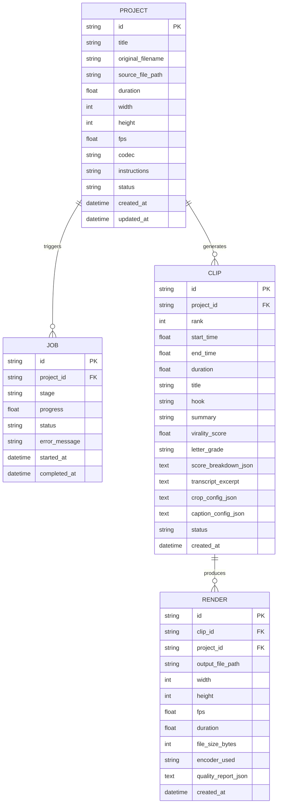

# ClipForge — Database Architecture & Schema

## 1. Storage Choice: SQLite with WAL Mode
ClipForge uses local **SQLite** for all structured metadata.
- Zero server setup or maintenance.
- Single file: `c:\clipper\data\database\clipforge.db`.
- High concurrency and reliability enabled via Write-Ahead Logging (`PRAGMA journal_mode=WAL;`).
- Fast querying with indexed foreign keys.

---

## 2. Entity-Relationship Model



---

## 3. SQL Table Definitions

```sql
CREATE TABLE IF NOT EXISTS projects (
    id TEXT PRIMARY KEY,
    title TEXT NOT NULL,
    original_filename TEXT NOT NULL,
    source_file_path TEXT NOT NULL,
    duration REAL DEFAULT 0.0,
    width INTEGER DEFAULT 0,
    height INTEGER DEFAULT 0,
    fps REAL DEFAULT 0.0,
    codec TEXT,
    instructions TEXT,
    status TEXT NOT NULL DEFAULT 'created',
    created_at TIMESTAMP DEFAULT CURRENT_TIMESTAMP,
    updated_at TIMESTAMP DEFAULT CURRENT_TIMESTAMP
);

CREATE TABLE IF NOT EXISTS jobs (
    id TEXT PRIMARY KEY,
    project_id TEXT NOT NULL REFERENCES projects(id) ON DELETE CASCADE,
    stage TEXT NOT NULL DEFAULT 'pending',
    progress REAL NOT NULL DEFAULT 0.0,
    status TEXT NOT NULL DEFAULT 'pending', -- pending, running, completed, failed, cancelled
    error_message TEXT,
    started_at TIMESTAMP,
    completed_at TIMESTAMP
);

CREATE TABLE IF NOT EXISTS clips (
    id TEXT PRIMARY KEY,
    project_id TEXT NOT NULL REFERENCES projects(id) ON DELETE CASCADE,
    rank INTEGER NOT NULL DEFAULT 1,
    start_time REAL NOT NULL,
    end_time REAL NOT NULL,
    duration REAL NOT NULL,
    title TEXT NOT NULL,
    hook TEXT,
    summary TEXT,
    virality_score REAL NOT NULL DEFAULT 0.0,
    letter_grade TEXT NOT NULL DEFAULT 'B',
    score_breakdown_json TEXT,
    transcript_excerpt TEXT,
    crop_config_json TEXT,
    caption_config_json TEXT,
    status TEXT NOT NULL DEFAULT 'suggested', -- suggested, edited, rendered
    created_at TIMESTAMP DEFAULT CURRENT_TIMESTAMP
);

CREATE TABLE IF NOT EXISTS renders (
    id TEXT PRIMARY KEY,
    clip_id TEXT NOT NULL REFERENCES clips(id) ON DELETE CASCADE,
    project_id TEXT NOT NULL REFERENCES projects(id) ON DELETE CASCADE,
    output_file_path TEXT NOT NULL,
    width INTEGER NOT NULL DEFAULT 1080,
    height INTEGER NOT NULL DEFAULT 1920,
    fps REAL NOT NULL DEFAULT 30.0,
    duration REAL NOT NULL,
    file_size_bytes INTEGER NOT NULL,
    encoder_used TEXT NOT NULL DEFAULT 'h264_nvenc',
    quality_report_json TEXT,
    created_at TIMESTAMP DEFAULT CURRENT_TIMESTAMP
);

CREATE INDEX IF NOT EXISTS idx_jobs_project ON jobs(project_id);
CREATE INDEX IF NOT EXISTS idx_clips_project ON clips(project_id);
CREATE INDEX IF NOT EXISTS idx_renders_clip ON renders(clip_id);
```
